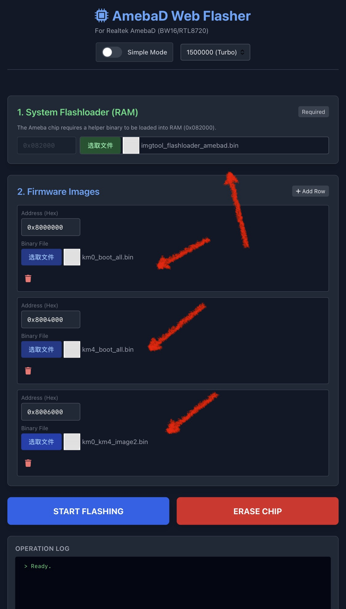

# BW16 Nethercap firmware no trial

BW16 / RTL8720DN only.

## 中文

刷机网页：https://nethercap-web-flasher-v2.vercel.app

| 文件 | 地址 |
|---|---|
| `imgtool_flashloader_amebad.bin` | `0x082000` |
| `km0_boot_all.bin` | `0x08000000` |
| `km4_boot_all.bin` | `0x08004000` |
| `km0_km4_image2-4.bin` | `0x08006000` |

按教程图选文件，进下载模式，点 START FLASHING。刷完打开 `8.8.8.8`。

捐赠（自愿，金额随意）
- EVM (ETH / BNB): `0x0c230520e1419b1ccd2e54db80d15ae70edada9d`
- Solana: `7j2EcTBB7haUZtmKj27JDBLTWJ4tpfwj8fwWvAfyqwZf`

## English

Web flasher: https://nethercap-web-flasher-v2.vercel.app

| File | Address |
|---|---|
| `imgtool_flashloader_amebad.bin` | `0x082000` |
| `km0_boot_all.bin` | `0x08000000` |
| `km4_boot_all.bin` | `0x08004000` |
| `km0_km4_image2-4.bin` | `0x08006000` |

Follow the tutorial image, enter download mode, click START FLASHING. After flashing, open `8.8.8.8`.

Donations (voluntary, any amount)
- EVM (ETH / BNB): `0x0c230520e1419b1ccd2e54db80d15ae70edada9d`
- Solana: `7j2EcTBB7haUZtmKj27JDBLTWJ4tpfwj8fwWvAfyqwZf`
